<p align="center">
  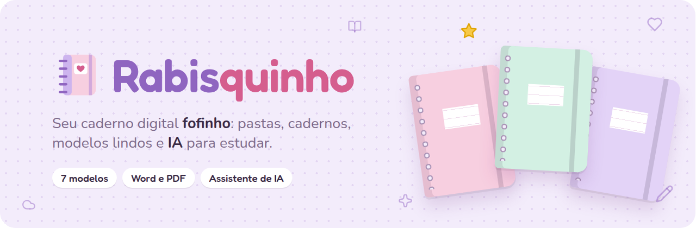
</p>

# Rabisquinho

**Um caderno digital fofinho para estudar.** Organize suas anotações em **pastas** e **cadernos**, escreva com atalhos simples e baixe tudo em **Word (.docx)** ou **PDF**, em modelos lindos de caderno. Ele também tem um **assistente de IA** que resume, organiza e cria perguntas de revisão.

Tudo fica salvo no seu navegador: sem login, sem servidor, sem instalar nada.

<p align="center">
  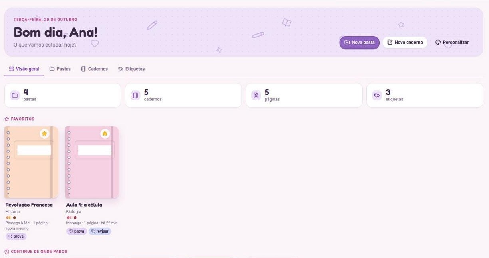
</p>

---

## Sumário

1. [Recursos](#1-recursos)
2. [Modelos](#2-modelos)
3. [Como escrever](#3-como-escrever)
4. [Assistente de IA](#4-assistente-de-ia)
5. [Rodar no computador](#5-rodar-no-computador)
6. [Publicar](#6-publicar)
7. [Estrutura do projeto](#7-estrutura-do-projeto)
8. [Próximos passos](#8-próximos-passos)

---

## 1. Recursos

- **Pastas e cadernos.** Cada pasta tem ícone e cor; cada caderno tem capa colorida, espiral e etiqueta. Marque favoritos com a estrela e use etiquetas como "prova" e "revisar".
- **Início com a sua cara.** Abas (Visão geral, Pastas, Cadernos, Etiquetas), saudação com o seu nome, cor do site, desenhinhos animados e escolha das seções que aparecem.
- **Editor feito para escrever.** Abas Escrever, Modelo, Info, Capas e IA, barra de formatação e três modos: só escrever, lado a lado ou só a prévia.
- **Várias páginas por caderno.** E quando uma página fica grande, a prévia quebra sozinha em várias folhas, com cabeçalho, rodapé e número.
- **Capas e imagens.** Faixa com foto ou estampa em cima de cada capítulo, e imagens no meio do texto (botão ou Ctrl+V).
- **Word e PDF.** O .docx sai em duas colunas, com cabeçalho, rodapé e número de página. O PDF sai igual à prévia.
- **Busca.** Procura em títulos, etiquetas e no texto de todas as páginas, sem se importar com acentos.
- **Backup.** Um arquivo `.json` com tudo, para trocar de computador ou guardar.
- **Tour de boas-vindas.** Na primeira visita, 6 passos curtos explicam como tudo funciona. Dá para rever pelo botão **?** no topo.

<p align="center">
  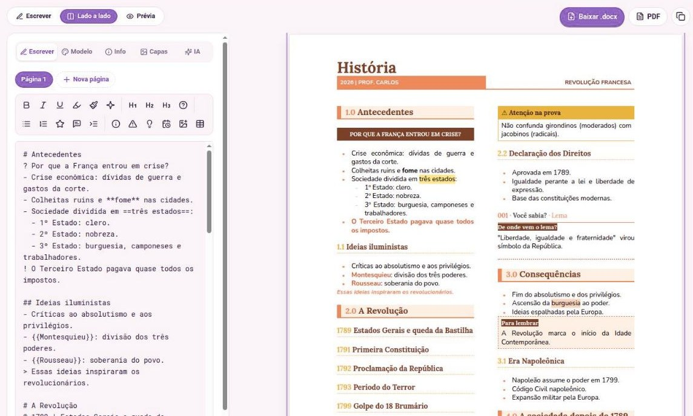<br>
  <sub><b>Editor</b>: o texto de um lado, a folha pronta do outro</sub>
</p>

<p align="center">
  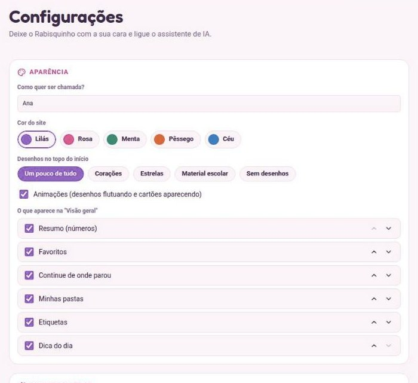<br>
  <sub><b>Configurações</b>: deixe o Rabisquinho com a sua cara</sub>
</p>

---

## 2. Modelos

Sete modelos próprios, cada um com cores, fontes e jeito de montar a página. Todos funcionam em **A4** ou **Carta**.

<table>
  <tr>
    <td align="center" width="25%">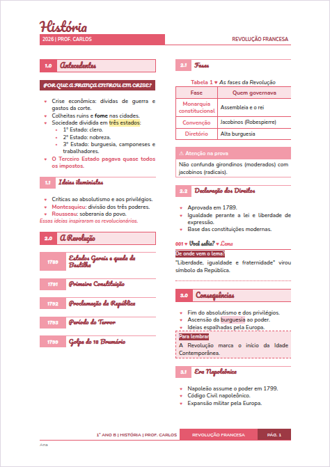<br><b>Morango</b><br><sub>rosa, vermelho e creme</sub></td>
    <td align="center" width="25%">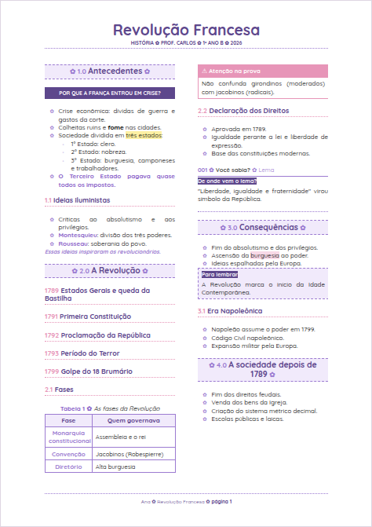<br><b>Lavanda</b><br><sub>lilás, roxo e rosa clarinho</sub></td>
    <td align="center" width="25%">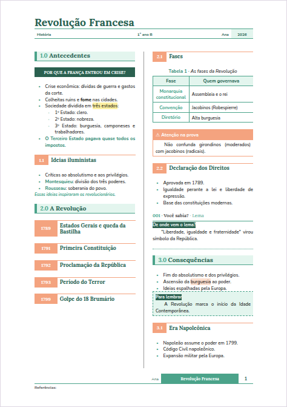<br><b>Menta</b><br><sub>verde menta e pêssego</sub></td>
    <td align="center" width="25%">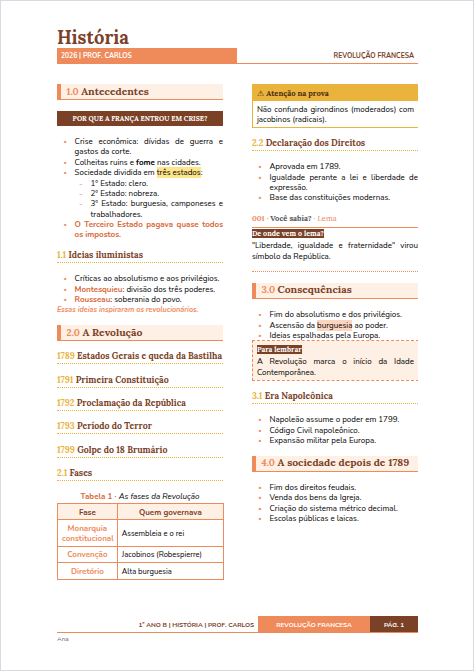<br><b>Pêssego & Mel</b><br><sub>pêssego, mel e marrom</sub></td>
  </tr>
  <tr>
    <td align="center">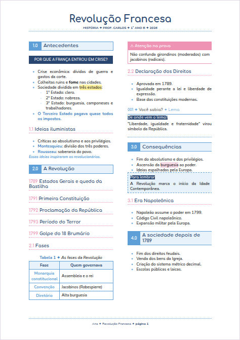<br><b>Céu de Algodão</b><br><sub>azul bebê, marinho e rosa</sub></td>
    <td align="center">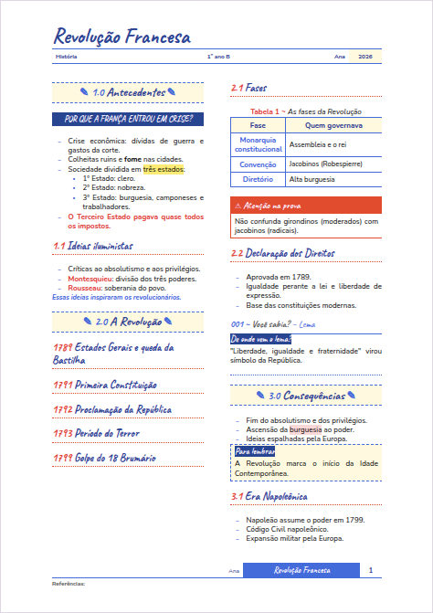<br><b>Rabisco</b><br><sub>jeito de escrito à mão</sub></td>
    <td align="center">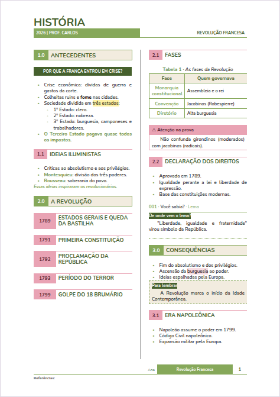<br><b>Matcha Latte</b><br><sub>matcha, bege e rosa</sub></td>
    <td></td>
  </tr>
</table>

---

## 3. Como escrever

Cada linha vira um pedaço do caderno. A barra de formatação escreve os símbolos para você, mas dá para digitar direto:

| Escreva | Vira |
| --- | --- |
| `# Título` | Tópico principal (1.0, 2.0…) |
| `## Subtítulo` | Subtópico (1.1, 1.2…) |
| `? Pergunta` | Faixa com a pergunta-chave |
| `- texto` / `1. texto` | Marcador / lista numerada |
| `! termo` | Termo importante |
| `>> Título \| texto` | Caixa de observação |
| `!!! Título \| texto` | Caixa de alerta |
| `?! Tema \| pergunta \| resposta` | "Você sabia?" |
| `@ 1789 \| evento` | Linha do tempo |
| `\| a \| b \|` | Tabela |
| `**negrito**` `==marca-texto==` `{{termo}}` | Destaques |

A lista completa está em [`docs/SINTAXE.md`](docs/SINTAXE.md).

---

## 4. Assistente de IA

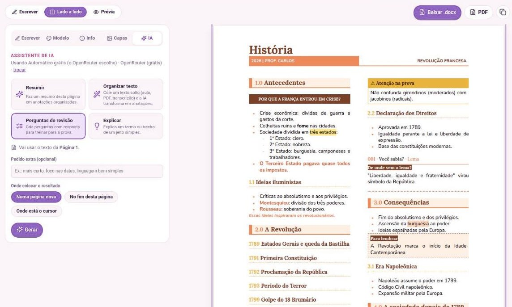

Na aba **IA** do editor:

| Tarefa | O que faz |
| --- | --- |
| **Resumir** | Resume uma página (ou um intervalo de páginas) em anotações |
| **Organizar texto** | Transforma um texto colado (aula, PDF, transcrição) em anotações |
| **Perguntas de revisão** | Cria perguntas com resposta, das páginas que você escolher |
| **Explicar** | Explica um termo ou trecho de um jeito simples |

A resposta já vem no formato do caderno e pode ir para uma página nova, para o fim da página ou para onde está o cursor.

Em **Configurações → Assistente de IA**, escolha o provedor e cole a sua chave:

| Provedor | Chave | Modelos |
| --- | --- | --- |
| **Claude (Anthropic)** | [console.anthropic.com](https://console.anthropic.com/settings/keys) | Claude Opus 5.5 (padrão), Sonnet 5.5 ou Haiku 5.5. Cobrado na sua conta. |
| **OpenRouter** | [openrouter.ai](https://openrouter.ai/settings/keys) | **Só modelos gratuitos.** O padrão (`openrouter/free`) escolhe sozinho um modelo grátis disponível. |

A chave fica guardada só no navegador e vai direto para o provedor.

---

## 5. Rodar no computador

O site usa módulos JavaScript, então precisa ser aberto por um servidor (dois cliques no `index.html` não funcionam):

```sh
python3 -m http.server 8000
```

Depois abra http://localhost:8000

---

## 6. Publicar

É um site estático: só HTML, CSS e JavaScript, sem etapa de build.

| Onde | Como |
| --- | --- |
| **Netlify** | Arraste a pasta do projeto em [app.netlify.com/drop](https://app.netlify.com/drop), ou conecte o repositório |
| **Vercel** / **Cloudflare Pages** | Importe o repositório, sem comando de build |
| **GitHub Pages** | *Settings → Pages → Deploy from a branch*, pasta raiz (só em repositório público no plano grátis) |

---

## 7. Estrutura do projeto

```
index.html            página única do site
css/                  base, início, editor e impressão
img/logo.svg          logo e ícone da aba
js/
  main.js             rotas (#/...), backup, busca, caderno de exemplo
  app/state.js        estado compartilhado entre as telas
  ai/assistant.js     assistente de IA (Anthropic ou OpenRouter)
  data/               salvamento no navegador, modelos e exemplo
  engine/             texto → blocos → prévia (HTML) e Word (.docx)
  ui/                 cartões, cores, janelas, barra de formatação, capas, preferências, tour
  views/              uma tela por arquivo: início, pasta, editor, busca, etiqueta, configurações
docs/
  SINTAXE.md          todos os símbolos de formatação
  ROADMAP.md          o que já tem e o que vem
  brand/              capa deste README (readme-hero.html gera o .png)
  images/             prints usados aqui
```

```
texto do caderno ──syntax.js──▶ blocos ──model.js──▶ modelo ──┬─html.js──▶ prévia (e PDF)
                                                              └─docx.js──▶ arquivo .docx
```

Bibliotecas, todas por CDN: [JSZip](https://stuk.github.io/jszip/) (monta o .docx), [Lucide](https://lucide.dev) (ícones), o [SDK da Anthropic](https://github.com/anthropics/anthropic-sdk-typescript) (só carrega quando a IA é usada) e fontes do Google Fonts.

---

## 8. Próximos passos

Arrastar e soltar cadernos, lixeira, modo flashcards, login com sincronização entre aparelhos e app no celular (PWA). A lista completa está em [`docs/ROADMAP.md`](docs/ROADMAP.md).
